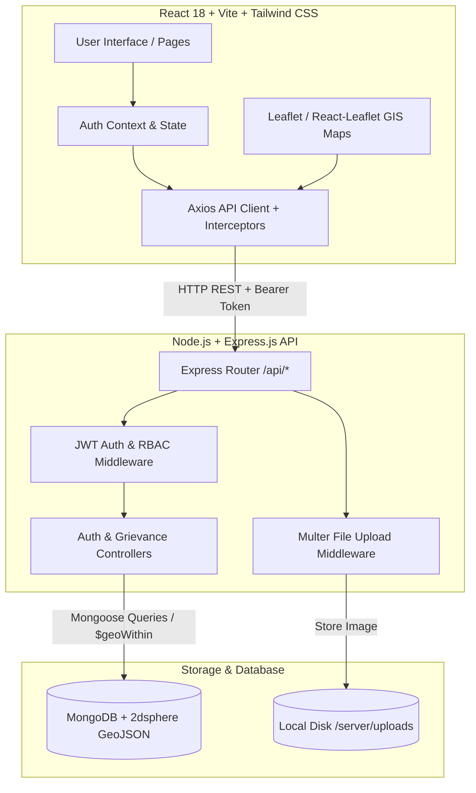

# CivicEye (BMC-G) Technical Documentation & Architecture Guide

**CivicEye** is a full-stack municipal civic grievance management and GIS geotagging platform. It bridges citizens and municipal field workers (BMC) by allowing citizens to report geotagged civic defects (potholes, pipeline leaks, dangling live wires, garbage dumps) with photographic proof and exact GPS coordinates, while enabling municipal staff to inspect, filter, and resolve issues via an interactive geospatial map dashboard.

---

## 1. System Architecture & Tech Stack



### Core Technologies

| Layer | Technologies | Purpose |
| :--- | :--- | :--- |
| **Frontend** | React 18, Vite, Tailwind CSS, Lucide Icons | Responsive single-page application (SPA) |
| **GIS / Mapping** | Leaflet, React-Leaflet, OpenStreetMap | Interactive geotagging & viewport querying |
| **Client State / Networking** | React Context API, Axios | JWT authentication state & REST communication |
| **Backend Runtime** | Node.js, Express.js | REST API server, routing, error handling |
| **Database & GIS Engine** | MongoDB (v7.0), Mongoose ODM | `2dsphere` spatial indexing, GeoJSON storage |
| **File Handling** | Multer | Multipart photo uploads with mime-type filtering |
| **Security** | JSON Web Tokens (`jsonwebtoken`), `bcryptjs` | Stateless session tokens & salt-hashed passwords |
| **DevOps & Containerization** | Docker, Docker Compose | Multi-container automated orchestration |

---

## 2. Directory Structure

```
BMC-G/
├── client/
│   ├── public/
│   ├── src/
│   │   ├── components/
│   │   │   ├── LocationPicker.jsx   # Geotag location selector with draggable pin
│   │   │   ├── MapView.jsx          # Interactive Leaflet map with status popups
│   │   │   ├── Navbar.jsx           # Top navigation with role indicators
│   │   │   └── ProtectedRoute.jsx   # RBAC route guard component
│   │   ├── context/
│   │   │   └── AuthContext.jsx      # Global user & token state provider
│   │   ├── pages/
│   │   │   ├── CitizenMyReports.jsx # Citizen submissions tracking page
│   │   │   ├── CitizenReport.jsx    # Issue reporting form with camera/GPS
│   │   │   ├── Login.jsx            # Sign-in page with demo quick-fill
│   │   │   ├── PublicMap.jsx        # Public live issue explorer
│   │   │   ├── Register.jsx         # Sign-up page with role selector
│   │   │   └── WorkerDashboard.jsx  # Worker dispatch & triage split dashboard
│   │   ├── services/
│   │   │   └── api.js               # Axios instance, interceptors, API service objects
│   │   ├── utils/
│   │   │   └── leafletIcons.js      # Custom SVG map pin generators & Leaflet fixes
│   │   ├── App.jsx                  # Main router setup & role redirector
│   │   ├── index.css                # Tailwind directives & marker pulse animations
│   │   └── main.jsx                 # React root renderer
│   ├── Dockerfile                   # Client container definition
│   ├── index.html                   # HTML entry point
│   ├── package.json                 # Frontend dependencies
│   ├── postcss.config.js            # PostCSS configuration
│   ├── tailwind.config.js           # Tailwind theme configuration
│   └── vite.config.js               # Vite build configuration
├── server/
│   ├── config/
│   │   └── db.js                    # MongoDB connection initialization
│   ├── controllers/
│   │   ├── authController.js        # User registration, login, and profile fetching
│   │   └── grievanceController.js   # Grievance CRUD, GIS bounding box & aggregation stats
│   ├── middleware/
│   │   ├── auth.js                  # JWT verification & role authorization (RBAC)
│   │   └── upload.js                # Multer image storage & file validation
│   ├── models/
│   │   ├── Grievance.js             # GeoJSON Point schema + 2dsphere index
│   │   └── User.js                  # User credentials, roles, and bcrypt hook
│   ├── routes/
│   │   ├── authRoutes.js            # /api/auth endpoints
│   │   └── grievanceRoutes.js       # /api/grievances endpoints
│   ├── uploads/                     # Uploaded photo files directory
│   ├── Dockerfile                   # Containerization specification for Express
│   ├── package.json                 # Server dependencies & scripts
│   ├── seeder.js                    # Mumbai sample dataset generator
│   └── server.js                    # Main Express server entrypoint
├── docker-compose.yml               # Multi-container service definitions
├── DOCUMENTATION.md                 # Technical project documentation
└── README.md                        # Quick start guide & demo accounts
```

---

## 3. Backend Deep Dive: Files & Logic

### `server/server.js`
**Purpose:** The central entry point and bootstrap script for the Express backend.

#### Underlying Logic:
1. **Environment & Database:** Invokes `dotenv.config()` and triggers `connectDB()`.
2. **CORS Configuration:** Enables cross-origin requests across all standard HTTP methods (`GET`, `POST`, `PUT`, `PATCH`, `DELETE`, `OPTIONS`) to allow frontend communication from any host.
3. **Body Parsing:** Registers `express.json()` and `express.urlencoded({ extended: true })` for processing JSON payloads and URL-encoded forms.
4. **Static Assets:** Serves `/server/uploads` statically at the route `/uploads` using `express.static()`, making uploaded grievance images directly accessible to browsers.
5. **Route Registration:** Mounts `authRoutes` at `/api/auth` and `grievanceRoutes` at `/api/grievances`.
6. **Centralized Error Middleware:** Catches unhandled runtime exceptions, Multer upload errors, Mongoose schema validation failures, and duplicate key errors (`code: 11000`), returning structured JSON error payloads with appropriate HTTP status codes.

---

### `server/config/db.js`
**Purpose:** Manages the Mongoose connection lifecycle to MongoDB.

#### Underlying Logic:
- Uses `mongoose.connect()` pointing to `process.env.MONGO_URI` with a fallback to `mongodb://127.0.0.1:27017/civic_grievance_db`.
- Gracefully handles connection failures by logging the error message and terminating the process (`process.exit(1)`) to avoid running in an orphaned state.

---

### `server/models/User.js`
**Purpose:** Defines the user database schema, access control roles, and cryptographic password hashing.

#### Underlying Logic:
- **Fields:** `name`, `email` (unique, lowercased, validated by email regex), `password` (min 6 characters), and `role` (`citizen` or `worker`, defaulting to `citizen`).
- **Mongoose Pre-Save Middleware (`pre('save')`):** Checks if the `password` field was modified. If modified/created, it generates a salt using `bcrypt.genSalt(10)` and replaces the plain-text password with the resulting hash before saving to MongoDB.
- **Instance Method (`matchPassword`):** Compares an incoming plain-text password with the stored hash using `bcrypt.compare()`.

---

### `server/models/Grievance.js`
**Purpose:** Defines the schema for reported civic issues, including GeoJSON geographical points and lifecycle status.

#### Underlying Logic:
- **Category & Status Enums:**
  - `category`: `['pothole', 'burst_pipe', 'hanging_wire', 'garbage', 'other']`.
  - `status`: `['PENDING', 'IN_PROGRESS', 'RESOLVED']` (defaults to `PENDING`).
- **GeoJSON Location Object:**
  - Implements the strict GeoJSON format:
    ```javascript
    location: {
      type: { type: String, enum: ['Point'], default: 'Point' },
      coordinates: { type: [Number], required: true } // [longitude, latitude]
    }
    ```
  - Validates coordinate bounds: Longitude must be between $-180$ and $180$, Latitude between $-90$ and $90$.
- **Geospatial Indexing:** Applies `grievanceSchema.index({ location: '2dsphere' })`. This enables MongoDB to execute fast 2D sphere geometry queries, including bounding-box `$geoWithin` and radius `$near` searches.
- **Relationships:** Defines `reportedBy` (reference to reporting `User`) and `assignedWorker` (reference to assigned BMC `User`).

---

### `server/middleware/auth.js`
**Purpose:** Protects private endpoints and provides Role-Based Access Control (RBAC).

#### Underlying Logic:
- **`protect` Middleware:** Extracts the Bearer token from the `Authorization` request header. Decodes and verifies the signature using `jwt.verify()`. Fetches the corresponding user record from MongoDB (omitting the password) and attaches it to `req.user`. Returns `401 Unauthorized` if invalid or absent.
- **`authorize(...roles)` Middleware:** Higher-order middleware that verifies if `req.user.role` is included in the allowed roles list. Rejects unauthorized access with `403 Forbidden`.

---

### `server/middleware/upload.js`
**Purpose:** Handles multipart form uploads for grievance proof photos.

#### Underlying Logic:
- **Disk Storage Configuration:** Configures `multer.diskStorage`. Saves files to `/server/uploads/` with a unique name template: `grievance-<timestamp>-<randomNumber>.<ext>`.
- **MIME Type Whitelisting:** Restricts uploads strictly to images (`image/jpeg`, `image/png`, `image/webp`, `image/jpg`, `image/gif`, `image/heic`, `image/heif`).
- **Upload Limit:** Enforces a 10MB maximum file size limit.

---

### `server/controllers/authController.js`
**Purpose:** Contains request handler logic for authentication and profile management.

#### Underlying Logic:
- **`register`:** Validates fields, checks for duplicate email addresses, creates the `User` document, generates a JWT signed with `user._id`, and returns user details with the token.
- **`login`:** Finds user by email, executes `user.matchPassword(password)`, generates a 30-day JWT, and returns user data.
- **`getMe`:** Returns the authenticated user's profile details based on `req.user._id`.

---

### `server/controllers/grievanceController.js`
**Purpose:** Executes core business logic for civic grievances, spatial queries, and status updates.

#### Underlying Logic:
- **`createGrievance`:**
  - Extracts title, description, category, and coordinates (`latitude`, `longitude`).
  - Verifies presence of `req.file` (photo proof is mandatory).
  - Validates numeric latitude/longitude bounds.
  - Formats coordinates strictly into `[longitude, latitude]` for GeoJSON compliance and stores the relative photo path (`/uploads/filename.ext`).
- **`getMapViewGrievances` (Bounding Box Filter):**
  - Accepts query parameters: `swLat`, `swLng`, `neLat`, `neLng`, `status`, and `category`.
  - When bounding coordinates are supplied, it constructs a MongoDB `$geoWithin` query using the `$box` operator:
    ```javascript
    location: {
      $geoWithin: {
        $box: [
          [parseFloat(swLng), parseFloat(swLat)], // Bottom-Left SW [lng, lat]
          [parseFloat(neLng), parseFloat(neLat)]  // Top-Right NE [lng, lat]
        ]
      }
    }
    ```
  - Applies optional `status` and `category` filters, populates user relationships, and returns the top 300 matching issues.
- **`updateStatus` (Worker Only):**
  - Updates issue status (`PENDING` $\rightarrow$ `IN_PROGRESS` $\rightarrow$ `RESOLVED`).
  - Automatically sets `assignedWorker = req.user._id` if the grievance was unassigned.
- **`getMyGrievances`:** Returns all grievances created by `req.user._id` sorted newest first.
- **`getStats`:** Executes parallel MongoDB queries (`countDocuments` and `$group` aggregation) to compute metrics: total reports, pending count, in-progress count, resolved count, and breakdown by category.

---

### `server/routes/authRoutes.js` & `server/routes/grievanceRoutes.js`
**Purpose:** Map HTTP verbs and URI paths to their controller actions and middlewares.

| Route | Method | Access | Middleware | Controller Handler |
| :--- | :--- | :--- | :--- | :--- |
| `/api/auth/register` | `POST` | Public | None | `register` |
| `/api/auth/login` | `POST` | Public | None | `login` |
| `/api/auth/me` | `GET` | Private | `protect` | `getMe` |
| `/api/grievances/map-view` | `GET` | Public | None | `getMapViewGrievances` |
| `/api/grievances/stats` | `GET` | Public | None | `getStats` |
| `/api/grievances` | `POST` | Private | `protect`, `upload.single('photo')` | `createGrievance` |
| `/api/grievances/my` | `GET` | Private | `protect` | `getMyGrievances` |
| `/api/grievances/:id` | `GET` | Public | None | `getGrievanceById` |
| `/api/grievances/:id/status`| `PATCH`| Private (Worker)| `protect`, `authorize('worker')` | `updateStatus` |

---

### `server/seeder.js`
**Purpose:** Development database initializer.

#### Underlying Logic:
- Clears existing `User` and `Grievance` collections.
- Creates test citizen accounts (`citizen.rahul@example.com`) and BMC worker accounts (`bmc.worker@mumbai.gov.in`).
- Seeds realistic municipal issues across Mumbai neighborhoods (Andheri, Bandra, Dadar, Kurla, Colaba, Borivali) with exact GeoJSON coordinates, categories, statuses, and photos.

---

## 4. Frontend Deep Dive: Files & Logic

### `client/src/services/api.js`
**Purpose:** Centralized Axios HTTP client configuration and endpoint functions.

#### Underlying Logic:
- **Base URL Configuration:** Reads `import.meta.env.VITE_API_BASE_URL` (defaults to `http://localhost:5000`).
- **Request Interceptor:** Automatically reads `civic_token` from `localStorage` and injects `Authorization: Bearer <token>` on all outgoing HTTP calls.
- **Service Modules:** Exports `authService` (login, register, getMe) and `grievanceService` (`createGrievance`, `getMapView`, `updateStatus`, `getMyGrievances`, `getStats`, `getById`).
- **Helper `getPhotoUrl`:** Transforms relative photo paths (e.g., `/uploads/grievance-123.jpg`) into absolute URLs pointing to the backend static file server.

---

### `client/src/context/AuthContext.jsx`
**Purpose:** Provides global authentication and authorization state throughout the React component tree.

#### Underlying Logic:
- **Initialization:** On initial mount, reads `civic_token` and `civic_user` from `localStorage` and immediately verifies token validity via `authService.getMe()`. If the session is invalid or expired, it automatically calls `logout()`.
- **Actions:** Exposes `login()`, `register()`, and `logout()` functions that update state and synchronize with `localStorage`.
- **Role Helpers:** Computes boolean flags `isCitizen` and `isWorker` for conditional rendering across components.

---

### `client/src/components/ProtectedRoute.jsx`
**Purpose:** Client-side route guard preventing unauthenticated or unauthorized role access.

#### Underlying Logic:
- Displays a spinner while `loading` is true.
- If `!isAuthenticated`, redirects the browser to `/login` and preserves the attempted route in `state.from`.
- If `allowedRoles` are specified and the user's role does not match, redirects citizens to `/report` and workers to `/worker-dashboard`.

---

### `client/src/components/LocationPicker.jsx`
**Purpose:** Interactive Leaflet map picker used inside the grievance reporting form.

#### Underlying Logic:
- **Interactive Pin:** Displays a custom draggable marker (`pickerIcon`). When the pin is dragged (`dragend`), it updates parent state with new latitude and longitude.
- **Map Click Handler:** Uses Leaflet's `useMapEvents({ click })` to move the pin wherever the user clicks on the map.
- **Smooth Navigation:** Sub-component `MapEventsHandler` uses `map.flyTo()` to smoothly animate to new coordinates when GPS auto-detection is triggered.
- **GPS Trigger:** Features an **"Auto-Detect GPS"** button that invokes the browser's `navigator.geolocation.getCurrentPosition()`.

---

### `client/src/components/MapView.jsx`
**Purpose:** The core interactive GIS map for viewing civic issues, filtering by status, and performing triage.

#### Underlying Logic:
- **Viewport Bounds Watcher:** Implements `MapViewportWatcher` hook with `useMapEvents({ moveend, zoomend })`. Whenever the map is panned or zoomed, it computes the bounding coordinates (`swLat`, `swLng`, `neLat`, `neLng`) and fires `onBoundsChange()` to trigger viewport-based data loading.
- **Dynamic Colored Markers:** Renders custom SVG markers for each grievance (`createGrievanceIcon`) colored by status:
  - 🔴 **Red:** `PENDING` (with CSS radar pulse animation)
  - 🟡 **Amber:** `IN_PROGRESS`
  - 🟢 **Green:** `RESOLVED`
- **Interactive Popups:** Shows issue title, category badge, date, reporter name, assigned worker, and a photo preview with click-to-enlarge modal support.
- **Worker Actions:** If `isWorker === true`, embeds interactive status buttons inside the popup (`In Progress`, `Mark Fixed`, `Reopen Issue`) allowing single-click updates directly from the map.

---

### `client/src/utils/leafletIcons.js`
**Purpose:** Resolves Leaflet asset bundling quirks and builds custom HTML/SVG map pins.

#### Underlying Logic:
- **Bundler Asset Fix:** Overrides Leaflet's default marker image URLs with CDN URLs to prevent asset resolution breakage in Vite production builds.
- **SVG Category Glyphs:** Contains inline SVG markup for category icons (`pothole`, `burst_pipe`, `hanging_wire`, `garbage`, `other`).
- **`createGrievanceIcon`:** Generates an `L.divIcon` incorporating background colors, status pulse animations, and category SVG glyphs.
- **`pickerIcon`:** Generates a teardrop location marker for the coordinate picker.

---

### `client/src/pages/CitizenReport.jsx`
**Purpose:** Issue reporting page for citizens.

#### Underlying Logic:
1. **Auto GPS on Mount:** Automatically invokes `navigator.geolocation.getCurrentPosition()` with `{ enableHighAccuracy: true }` upon opening.
2. **Camera Integration:** Configures the photo file input with `capture="environment"` so mobile users directly trigger their device camera.
3. **Form Fields:** Title, category selection cards, detailed description, and the interactive `LocationPicker`.
4. **Multipart Submission:** Constructs a `FormData` object with text fields, coordinates, and photo binary, dispatching it to `grievanceService.createGrievance()`.

---

### `client/src/pages/WorkerDashboard.jsx`
**Purpose:** Municipal worker operations hub for real-time triage and field dispatch.

#### Underlying Logic:
- **KPI Metrics Ribbon:** Displays live counts of Total, Pending, In Progress, and Resolved issues using `/api/grievances/stats`.
- **Split View Layout:** Left/Main panel renders `MapView`, while the right panel displays a list queue of issues in the current viewport.
- **Viewport Synchronization:** Clicking an item in the queue focuses and flies the map directly to that marker (`map.flyTo`). Panning the map re-queries the backend using current bounding box parameters.
- **Filters:** Dropdowns to filter the viewport by status (`PENDING`, `IN_PROGRESS`, `RESOLVED`) and category.

---

### `client/src/pages/CitizenMyReports.jsx`
**Purpose:** Citizen dashboard to track their submitted grievances.

#### Underlying Logic:
- Fetches user's reports from `/api/grievances/my`.
- Renders cards displaying issue photo, status badges, timestamp, exact coordinates, and assigned worker name.
- Provides a real-time client-side search bar filtering by title, category, or description.

---

### `client/src/pages/PublicMap.jsx`
**Purpose:** Public transparency portal allowing any citizen or guest to view all active and resolved municipal issues across the city without requiring an account.

---

### `client/src/pages/Login.jsx` & `client/src/pages/Register.jsx`
**Purpose:** User authentication and registration.

#### Underlying Logic:
- **Quick Fill Demo Buttons:** The login page provides pre-configured one-click buttons to log in as a **Citizen Demo** or **BMC Worker Demo**.
- **Role Selection:** Registration allows selecting between `Citizen (Reporter)` and `BMC Field Worker`.

---

### `client/src/App.jsx`
**Purpose:** Application router configuration.

#### Underlying Logic:
- **`RootRedirect` Component:** Automatically directs root `/` traffic: unauthenticated users $\rightarrow$ `/login`, workers $\rightarrow$ `/worker-dashboard`, citizens $\rightarrow$ `/report`.
- Wraps routes with `ProtectedRoute` enforcing role rules.

---

## 5. Key Architectural Mechanisms

### A. Geospatial Coordinate Handling (Leaflet vs MongoDB)

A common challenge in GIS development is coordinate ordering:
- **Leaflet & Browser GPS:** Follows `[Latitude, Longitude]` (e.g., Mumbai is `[19.0760, 72.8777]`).
- **MongoDB GeoJSON Standard:** Strictly requires `[Longitude, Latitude]` (`[x, y]`).

```
[Browser GPS / Leaflet]  lat: 19.0760, lng: 72.8777
           │
           ▼  (Converted during POST /api/grievances)
[MongoDB GeoJSON]         location.coordinates: [72.8777, 19.0760]
           │
           ▼  (Inverted back for Leaflet Map Rendering)
[React-Leaflet Marker]   position={[lat, lng]}
```

### B. Viewport Bounding-Box ($geoWithin $box) Querying

Instead of loading thousands of global records, the map queries only what is visible within the user's current screen:

1. Leaflet detects movement $\rightarrow$ calculates South-West `(swLat, swLng)` and North-East `(neLat, neLng)` bounds.
2. Frontend calls `/api/grievances/map-view?swLat=...&swLng=...&neLat=...&neLng=...`.
3. Express constructs a MongoDB query:
   ```javascript
   query.location = {
     $geoWithin: {
       $box: [
         [parseFloat(swLng), parseFloat(swLat)], // SW [lng, lat]
         [parseFloat(neLng), parseFloat(neLat)]  // NE [lng, lat]
       ]
     }
   };
   ```
4. MongoDB leverages the `2dsphere` index to return only matching documents in logarithmic time.

---

## 6. Deployment & Container Orchestration

The application is orchestrated via `docker-compose.yml`:

```yaml
version: '3.8'

services:
  mongo:
    image: mongo:7.0
    container_name: civic_mongo
    ports: ["27017:27017"]
    volumes:
      - mongo-data:/data/db
    networks: [civic-network]

  server:
    build: { context: ./server, dockerfile: Dockerfile }
    container_name: civic_server
    ports: ["5000:5000"]
    environment:
      - MONGO_URI=mongodb://mongo:27017/civic_grievance_db
      - JWT_SECRET=super_secret_jwt_key_for_civic_grievance_portal
    volumes:
      - ./server/uploads:/app/uploads # Host persistence for photos
    depends_on: [mongo]
    networks: [civic-network]

  client:
    build: { context: ./client, dockerfile: Dockerfile }
    container_name: civic_client
    ports: ["5173:5173"]
    environment:
      - VITE_API_BASE_URL=http://localhost:5000
    depends_on: [server]
    networks: [civic-network]

volumes:
  mongo-data:
```

### Commands:
```bash
# Build and run containers
docker-compose up --build

# Run seeder in container
docker exec -it civic_server npm run seed
```
